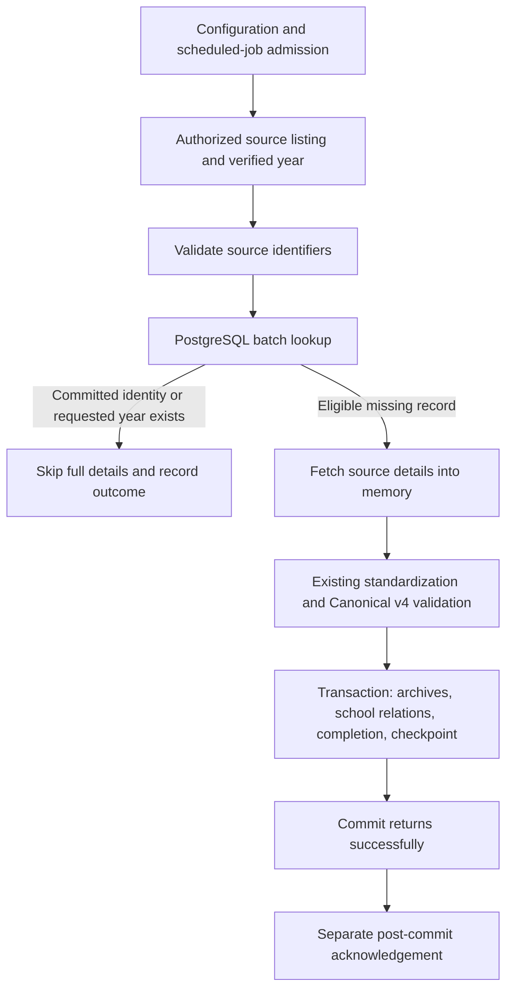

# School Data Scraping and Unified PostgreSQL Platform

**Intended submission:** 23 November 2026. **Verification date:** 22 November 2026. The intended date is a submission date, not a claim that tests ran in the future.

**Development:** implemented and tested within the documented scope. **Production deployment:** not ready for activation. The local Windows PC is the selected deployment target; the production database, credentials, services, monitoring and backup arrangements remain unapproved.

## 1. Executive project overview

This Python project collects school information from UDISE+ and CBSE SARAS, maps it to Canonical School Schema v4, validates source identity and data, and manages school records in PostgreSQL. It supports both the preserved file workflow and an explicit PostgreSQL-first, database-only workflow. The latter checks committed school identities before details and stores school payloads as JSONB without local raw/canonical school files.

The submission includes source collectors, shared policy/storage modules, the existing relational model and migrations, a read-only search API, automated tests, operational evidence and guarded deployment proposals. It does not claim national coverage, active unattended scheduling or production disaster recovery.

## 2. Problem statement

The two sources expose different identifiers, field names, detail structures and academic-year semantics. Repeated collections can duplicate work, confuse current summaries with historical-year details, overwrite observations or leave import completion unclear after a failure. A useful system must retain provenance, distinguish schools from annual snapshots, validate records consistently and avoid interpreting a successful process exit as proof of a committed school.

Source authorization and incomplete geographic listings create additional limits. The project therefore records scope and coverage evidence, respects manual authentication restrictions and separates implemented software from deployment approval.

## 3. Implemented solution

The three active entry points are `saras_dynamic_scraper.py`, `udise_dynamic_scraper.py` and `daily_scheduler.py`. Shared configuration resolves source/location settings and explicit CLI overrides. Candidate limits include skipped/filtered candidates; they are not a quota of new imports.

Database storage is opt-in through `--storage-mode database --database`, with `--new-only` for pre-detail committed-record skipping. `--refresh` represents a deliberate refresh and conflicts with new-only mode. Default storage remains files. Scheduled database-only jobs additionally require approved production admission and a bounded process timeout; direct scraper maintenance commands remain separately write-capable and are not an approval shortcut.

## 4. End-to-end architecture

The implemented database-only path is:



The existing `import_scraped_record()` pipeline is reused. It does not introduce a second school model or automatically merge cross-source matches. Operational reports and locks can be local; database-only school payloads are not written to disk. The legacy path retains raw JSON, immutable retry snapshots and journal-based recovery when deliberately selected.

## 5. Core modules and responsibilities

| Component | Responsibility |
|---|---|
| Root source scripts | Official discovery/details, source validation, filters, bounded collection and authorization stops |
| `school_scraping/config.py`, `datasets.py`, `common.py` | Configuration, dataset/year paths, source identity/PIN utilities, safe storage and process locks |
| `school_scraping/incremental.py` | Due/refresh/retry policy and shared file/database runtime lifecycle |
| `school_scraping/database_only.py` | Validated batch lookup, shared connection, in-memory import and commit/ACK boundaries |
| Standardizer, canonical mapper and validator modules | Existing source-specific conversion, Canonical v4 contracts and validation |
| `database/scrape_pipeline.py`, `load_school_tables.py` | Transactional archive/loading, source/master/year relationships and match candidates |
| `school_scraping/memory.py` | Existing lifecycle projection and preserved legacy durable journal/replay |
| `daily_scheduler.py`, `scheduler_safety.py`, `supervision.py` | Daily orchestration, mandatory database-only admission and bounded owned-process cleanup |
| `production_safety.py`, `readiness.py`, `windows_readiness.py` | Approved identity/schema/role/TLS checks and explicitly limited readiness evidence |
| `ack_reconciliation.py` | Read-only detection of missing ACKs and inconsistent completion/checkpoint evidence |
| `database/api/main.py` | Parameterized read-only searches against the existing school search view |
| `school_scraping/maintenance/` | Explicit audits, comparisons, summaries and missing-value analysis; not competing scheduled scrapers |

## 6. Technologies and libraries

The reviewed Windows environment uses 64-bit Python 3.14.6 and PostgreSQL 17.5 tools. `requirements.txt` records the runtime dependency versions/ranges; pytest 9.2.0 is installed in the reviewed test environment.

| Technology | Use |
|---|---|
| Playwright | SARAS browser interactions and legitimate attended source discovery where required |
| Requests | UDISE catalogue/detail HTTP requests |
| Beautiful Soup / lxml | HTML parsing |
| pandas / NumPy | Existing processing and maintenance dependencies |
| psycopg 3 | Parameterized PostgreSQL queries and transaction control |
| FastAPI / Uvicorn | Search API implementation and runtime |
| python-dotenv | Legacy environment loading; disabled for guarded production/review processes |
| zoneinfo / tzdata | Explicit timezone scheduling |
| unittest / pytest | Unit, mocked integration, guarded database tests and subtests |
| Python standard library / Windows Job Objects | Hashes, JSON, paths, locks, subprocess orchestration and owned-tree supervision |

Most dependency pins are exact, while some database/API dependencies use ranges. A complete OS/browser/package rebuild is still a deployment acceptance task; this is not a universal reproducible-runtime claim.

## 7. PostgreSQL data model

The current archive/school/tracking contract contains ten required tables:

| Tables | Purpose |
|---|---|
| `json_file_archive` | Serialized source/derived content, JSONB, hashes, logical provenance and historical observations |
| `school_entities` | Master school identities |
| `school_source_records` | Source identity, source-to-master/archive relationships and resolution metadata |
| `school_yearly_snapshots` | UDISE annual data linked to its source and archive |
| `school_match_candidates` | Reviewable UDISE/SARAS match evidence |
| `scrape_runs`, `scrape_tasks` | Operational scope, work state, attempts and outcomes |
| `scrape_events`, `scrape_errors` | Event identity, receipts and sanitized failure/resolution evidence |
| `scrape_checkpoints` | Detail/import state, hashes and subsequent-check policy |

DDL order is `database/schema.sql`, `database/schema_school_tables.sql`, then `database/migrations/001_scraping_memory.sql`. Source SQL uniqueness includes `(source_system, region, source_record_id)`; annual uniqueness is `(source_record_pk, academic_year)`. The model does not claim a new global affiliation constraint. The API's existing `school_master_search` view and its access policy need separate deployment verification.

## 8. Database-first school lookup logic

Listing identifiers are validated before parameterized lookups. The store reuses a connection and bounds each lookup batch to 500 identifiers. A queued task alone does not prove a committed school: lookups require compatible source/master/canonical evidence and, for UDISE, the requested annual snapshot.

New-only mode skips those committed identities before full details. Missing/incomplete identities remain eligible. A per-source/identifier advisory lock and existence recheck protect concurrent imports. Lookup/connection failures stop the database-only run; there is no silent switch to school-file storage.

## 9. SARAS and UDISE year-aware duplicate detection

SARAS uses the affiliation number. UDISE uses an 11-digit code and the requested academic year for collection eligibility. A school that exists for one year can still need another year's snapshot. Identifiers remain source identifiers; names and geographic aliases are not substitutes for identity.

Tests cover committed skips, missing-year eligibility, repeated imports and concurrent new-only attempts. Existing source resolution and ambiguous-identity handling are retained. Cross-source matching generates review candidates rather than automatic master-entity merges.

## 10. Canonical v4 mapping and validation

UDISE and SARAS keep their existing source-specific mappers and Python validators, with schema version `4.0`. The pipeline standardizes/maps in memory for database-only imports and validates identity, source/year consistency and the canonical structure before persistence.

Missing values remain distinguishable from zero. Dedicated source PIN evidence is preserved and checked; addresses are not used to invent PIN values. Source details, summary-year differences and provenance remain available for audit. A record passing mapping does not establish complete geographic coverage or prove every field was supplied by the source.

## 11. JSONB storage and historical records

Database-only imports store serialized raw records, canonical JSONB, content hashes, logical archive paths, historical observations and source/master/year relationships in PostgreSQL. The logical `data/...` keys are provenance, not physical file outputs. Existing historical raw files, backups and legacy journals are retained.

School data, completion evidence and detail checkpoint changes commit together. ACK follows only after that commit returns. Application logic preserves content-addressed history, but archive history/latest rows share an UPDATE-capable table: direct SQL history UPDATE is not separately prevented by current DDL. Immutable-event UPDATE is denied by the restricted-role design. No new history-protection migration is claimed.

## 12. Error handling and recovery

Mapping/validation/import failure before commit rolls back that transaction and must not claim completion. A lost connection during commit can leave an unknown outcome; a later run checks durable identity. An ACK failure after commit reports committed data separately from acknowledgement status. Read-only reconciliation detects inconsistencies without fabricating receipts, changing checkpoints or replaying imports.

Database-only mode has no offline full-payload spool; a crash before commit may require another detail fetch. Legacy file recovery retains fsynced events and immutable retry input under its separate mode. Manual authentication and HTTP 429 stop collection; bounded transient retries do not bypass those restrictions. A hard timeout is a failed scheduler job even if shutdown returns zero, while independently committed records remain valid.

## 13. Test methodology and evidence

Verification separates pure unit tests, mocked source/transaction tests, harmless process-containment tests, guarded disposable PostgreSQL integration and controlled live acceptance. Database tests require explicit test-only DSNs and identity guards; an absent DSN is reported as a skip rather than redirected to a historical database. New production SQL templates have static/offline checks, not an executed production or server-parser proof.

| Recorded run | Passed | Failed | Skipped | Subtests | Boundary |
|---|---:|---:|---:|---:|---|
| Section 14A PostgreSQL rehearsal, historical | 414 | 0 | 0 | 506 | New disposable SCRAM cluster; all 43 previously skipped PostgreSQL cases ran |
| Section 14B offline regression, historical | 392 | 0 | 43 | 618 | No database provisioning/connections; SQL/configuration preparation only |

Section 14A included real restricted-login imports, denied privileges, commit-before-ACK observation, rollback, new-target dump/restore and historical file-preservation checks. Its local unencrypted restore does not certify production/off-machine disaster recovery. Historical results are not mislabeled as the final submission run; the final audit records its actual test result separately.

## 14. Controlled live acceptance evidence

The retained public operational `acceptance_summary.json` records a successful Section 12A verification on 20 November 2026. Actual scope was one listing candidate per run in Chandigarh, delay 1.5 seconds and a 180-second supervised child bound. Each source had a new-record run and a repeat run against the same isolated database.

The local evidence is `.refactor_validation/database_only_live_acceptance/acceptance_summary.json` and its referenced `verified_execution/final_report.json`. Those retained operational artifacts are not a public deployment or a required data upload. This document reproduces only verified identifiers, counts and outcomes, without raw school payloads or access credentials.

| Evidence | SARAS | UDISE+ |
|---|---|---|
| Verified source identity | Affiliation `2600001` | Code `04010800107`, academic year 2025-26, source year ID 12 |
| New-record result | One committed and acknowledged school | One committed and acknowledged school/year |
| Counted core detail calls: new / repeat | 1 / 0 | 4 / 0 |
| Repeat evidence | Existing pre-detail skip; school archives unchanged | Existing requested-year skip; same source/snapshot identity and school archives unchanged |
| Validation/evidence | Canonical/raw JSONB, PIN preservation and completed checkpoint verified | Canonical/raw JSONB, PIN preservation and completed checkpoint verified |
| Local school payload files | 0 | 0 |

UDISE used an authorized saved official list and live year verification, not newly proven complete statewide listing discovery. Core detail-call counts exclude catalogue/discovery traffic. These controlled observations independently demonstrate a new import and a later skip; they are not a national coverage result, current source authorization guarantee or throughput benchmark. No live source request is made for this submission audit, and no personal/contact data or authenticated URL is reproduced here.

## 15. Local Windows scheduling design

The daily application schedule is 23:00 Asia/Kolkata, equivalent to 17:30 UTC. The original scheduler and default database integration remain disabled. Existing Haryana SARAS/PIN 134001 remains a latent configured example; it is not new production approval.

The internal loop arms a strictly future occurrence. A process armed at 22:59 can trigger at 23:00; a first start/restart at or after 23:00 waits until the next day. `last_run_date` prevents duplicates only within that process; no persistent daily-run deduplication or automatic catch-up was added. `--once` runs immediately and still requires applicable approval/admission.

Windows supervision assigns an isolated base-Python gate to a kill-on-close Job Object before launching the real venv/source/browser tree. Timeout/cancellation uses bounded cleanup and does not target all Python processes. A future Task Scheduler design uses an approved one-shot action with exact scope/year, bounds, no-overlap and separately approved missed-run/power policy. No scheduled task is installed or enabled. Current sleep/ACL and runtime-account conditions still require remediation approval and testing.

## 16. Security safeguards

The final audit reviewed current tracked/index content for credential/private-key/token/cookie/connection-secret patterns and classified credential-shaped test literals as synthetic fixtures; no finding remained in that reviewed scope. This is not a claim that every historical commit or private untracked artifact is safe to publish. No commit, push or additional data upload is performed by this submission preparation.

Ignore rules cover environment variants, private keys/certificates, authentication state, dumps and runtime backups. Production templates keep identity-dependent values unresolved and approvals false, protect historical ports/targets, and require reviewed routing, SCRAM/TLS, role/timeouts, backup/monitoring and scope. SQL guard checks cannot prevent the initial connection: future client routing must be validated before starting a database client.

The restricted scraper is separated from migration/report/backup duties and denied destructive/owner/server privileges. Reporting-group table access includes raw/canonical/contact data and is internal audit access, not a public analytics policy. NTFS, real credential/login/TLS deployment, monitoring delivery and data-release permissions remain operator decisions. Passwords, sessions, private certificates and authenticated URLs are not examples or submission content.

## 17. Known limitations

- Bounded candidates and supplied lists do not establish complete Chandigarh/Delhi/India-wide coverage, an exhaustive PIN denominator or fresh detail evidence for skipped schools.
- Current source access and UDISE discovery can require legitimate attended authorization; headless/cloud execution cannot remove CAPTCHA requirements.
- Database-only uncommitted payloads have no disk fallback; unknown commit/ACK gaps require durable-state inspection and separately approved recovery.
- Archive history is application-preserved, not database-enforced tamper-proof storage; current source SQL uniqueness is composite rather than a new global affiliation constraint.
- Readiness evidence is a local prototype; production monitoring, real alerts, encrypted/off-machine recovery, retention and RPO/RTO are not deployed or approved.
- Windows supervision evidence does not certify POSIX/cloud descendant containment. API rollout needs its reviewed search view, access controls and deployment policy.
- Dependency/browser/OS reconstruction, real-account NTFS/power/service behavior and newly prepared production SQL execution need further deployment acceptance.

## 18. Future production deployment requirements

Approve a dedicated new PostgreSQL target and restricted identities; never reuse historical/rehearsal databases or default routing. Review actual loopback/TLS/SCRAM, fresh data paths, role grants, durability and timeout settings. The guarded bootstrap/migrate/privileges/verify templates require future disposable syntax/error/negative tests, then separately authorized manual provisioning. Section 14B itself executed no production SQL.

Approve private credential/NTFS handling, Windows power/service/task model, real backup encryption/key custody/destination/retention and independent restore, monitoring delivery/escalation and rollback/cutover ownership. Only after these gates and current source authorization could a separately approved bounded one-shot be considered. Neither this submission nor a passing test suite authorizes continuous scheduling or production writes.

The detailed procedures and unresolved matrix are in [POSTGRESQL_PRODUCTION_SETUP.md](POSTGRESQL_PRODUCTION_SETUP.md) and [WINDOWS_LOCAL_DEPLOYMENT.md](WINDOWS_LOCAL_DEPLOYMENT.md).

## 19. How reviewers can reproduce safe offline tests

Use a fresh PowerShell process in the repository root and the reviewed existing venv with runtime requirements and pytest 9.2.0 installed. Installation is a separate environment-preparation step; no PostgreSQL startup, browser download, source session or secret file is needed for the offline suite. Some supervision tests start harmless local Python fixture processes; they do not start collectors or continuous scheduling.

The commands below remove test/database routing only from this shell's process environment, disable dotenv/plugin autoload and redirect explicit compilation caches outside source. They do not read/modify `.env`, register tasks, change Windows settings, delete files or require Git commands.

```powershell
$reviewPython = Join-Path (Get-Location) 'venv\Scripts\python.exe'
if (-not (Test-Path -LiteralPath $reviewPython -PathType Leaf)) {
  throw 'Prepare the reviewed test environment before continuing.'
}
$reviewSettings = @(
  'SCHOOL_SCRAPING_TEST_DSN', 'SCHOOL_SCRAPING_DATABASE_ONLY_TEST_DSN',
  'SCHOOL_SCRAPING_SECTION13B_TEST_DSN', 'SCHOOL_SCRAPING_PRODUCTION_SAFETY_TEST_DSN',
  'SCHOOL_SCRAPING_SECTION14A_GUARD', 'SCHOOL_SCRAPING_SECTION14A_ADMIN_DSN',
  'DB_HOST', 'DB_PORT', 'DB_NAME', 'DB_USER', 'DB_PASSWORD',
  'PGHOST', 'PGHOSTADDR', 'PGPORT', 'PGDATABASE', 'PGUSER', 'PGPASSWORD',
  'PGPASSFILE', 'PGSERVICE', 'PGSERVICEFILE', 'PGOPTIONS', 'UDISE_HEADERS_JSON',
  'PYTEST_ADDOPTS', 'PYTEST_PLUGINS'
)
foreach ($reviewSetting in $reviewSettings) {
  [Environment]::SetEnvironmentVariable($reviewSetting, $null, 'Process')
}
$env:PYTHON_DOTENV_DISABLED = '1'
$env:PYTHONDONTWRITEBYTECODE = '1'
$env:PYTEST_DISABLE_PLUGIN_AUTOLOAD = '1'
$reviewCache = Join-Path ([IO.Path]::GetTempPath()) ('school-submission-' + [Guid]::NewGuid().ToString('N'))
$env:PYTHONPYCACHEPREFIX = $reviewCache

& $reviewPython -m compileall -q school_scraping database
if ($LASTEXITCODE -ne 0) { throw 'Compilation failed; inspect the reported source location.' }

& $reviewPython -B -m pytest -q -rs -p no:cacheprovider
if ($LASTEXITCODE -ne 0) { throw 'Offline tests failed; retain and review the result.' }
```

Database cases should skip without their explicit DSNs; do not fill them with historical targets to eliminate skips. Removing the Section 14A guard variable matters: an empty-but-present guard key is not the same as no opt-in. Results can vary with platform/tool availability; report actual pass/fail/skip/subtest counts and reasons.

For focused review, use the same cleared environment and select the source/database-only, canonical/pipeline, scheduler/admission, supervision, production safety, ACK and Windows readiness tests:

```powershell
& $reviewPython -B -m pytest -q -rs -p no:cacheprovider `
  tests/test_saras_dynamic.py tests/test_udise_dynamic.py `
  tests/test_database_only.py tests/test_database_only_sources.py tests/test_database_only_end_to_end.py `
  tests/test_scrape_pipeline.py tests/test_pipeline_dynamic.py tests/test_scheduler_database_cycle.py `
  tests/test_config.py tests/test_scheduler.py tests/test_scheduler_safety.py tests/test_supervision.py `
  tests/test_production_safety.py tests/test_ack_reconciliation.py `
  tests/test_windows_readiness.py tests/test_production_postgresql_plan.py
```

Help and `daily_scheduler.py --config config/states_pincodes.json --dry-run` are additional offline scope checks. Do not execute mapper mains, imports, API startup, scraper runs or provisioning SQL merely to review the submission; those have separate output/access requirements.

### Suggested GitHub submission description

Python UDISE+/CBSE SARAS collection platform with PostgreSQL-first identity lookup, opt-in database-only Canonical v4 JSONB imports, annual snapshots, transactional completion/ACK evidence, controlled recovery, 23:00 IST scheduler supervision and fail-closed deployment preparation. Includes safe offline tests and documented isolated/live acceptance evidence; production scheduling and infrastructure remain disabled/unapproved.
